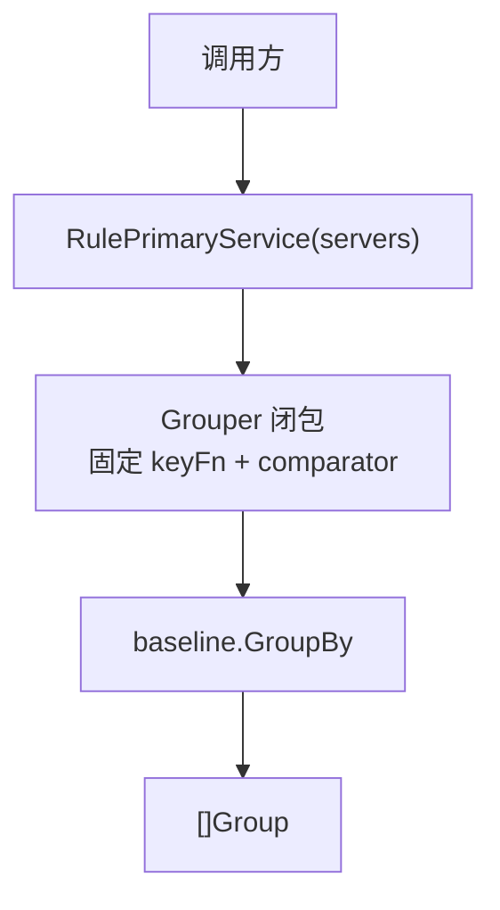

# 闭包组合 Dashboard 分组方案

本方案验证“规则本身就是函数”的高阶函数设计。每条规则是一个可直接调用的 `Grouper` 闭包，
调用方不传枚举，也不经过规则表查询。领域模型、分组骨架、排序和 fixture 继续复用
[baseline](../baseline/README.md)，本 package 仅声明闭包及其规则入口。

## 文件结构

| 文件 | 职责 |
| --- | --- |
| [`closure.go`](./closure.go) | `Grouper`、闭包构造器及五个规则函数变量 |
| [`model_aliases.go`](./model_aliases.go) | 复用 baseline 领域模型和状态/服务常量 |
| [`closure_test.go`](./closure_test.go) | 验证五个闭包结果与 baseline 对应规则一致，并提供可执行示例 |
| [`../cmd/closure-demo/main.go`](../cmd/closure-demo/main.go) | 演示直接调用闭包规则 |

## 架构



`makeGrouper` 捕获 key 函数与组间比较器，返回一个接受服务器列表并委托
`baseline.GroupBy` 的函数。服务器分组、未知/无服务保留、组内服务器排序、服务器内服务排序等
行为全部由 baseline 实现。

## 调用示例

```go
groups := closure.RulePrimaryService(servers)
```

也可以把规则函数作为值传递：

```go
var group closure.Grouper = closure.RuleExactConvention
groups := group(servers)
```

## 与其他方案比较

| 维度 | 闭包组合 | Data-driven | baseline switch |
| --- | --- | --- | --- |
| 规则载体 | `Grouper` 函数变量 | 枚举 `GroupRule` | 枚举 `GroupRule` |
| 调用形式 | `RulePrimaryService(servers)` | `RenderDashboard(servers, rule)` | `RenderDashboard(servers, rule)` |
| 规则选择成本 | 直接函数调用，不查表 | 映射表查找 | `switch` 分支 |
| 枚举与遍历 | 没有规则枚举；规则变量分散 | 有统一枚举，可映射遍历 | 有统一枚举，可显式列举 |
| 字符串解析 | 规则函数本身不能转换为规则名 | 支持 `ParseGroupRule` | 支持 `ParseGroupRule` |
| 规则变量 | 导出函数变量可能被调用方重新赋值 | 枚举标识不可被重新赋值 | 枚举标识不可被重新赋值 |

闭包调用最短、规则可以自然作为函数值传递；但规则不再是可枚举的数据，无法仅凭函数值完成
稳定名称解析、配置持久化或完整列表遍历。虽然可在外围额外维护名称到函数的映射，但这会重新引入
规则注册表。对于要求通过 API 或配置选择、解析规则的应用契约，闭包更适合作为内部组合手段，
不适合作为数据驱动方案的替代品。

## 运行与测试

```powershell
go run ./cmd/closure-demo
go test ./closure
go test ./...
```

共同行为由 baseline 测试覆盖；本方案测试只保证五个闭包与对应基线规则的关联没有配置错误。
