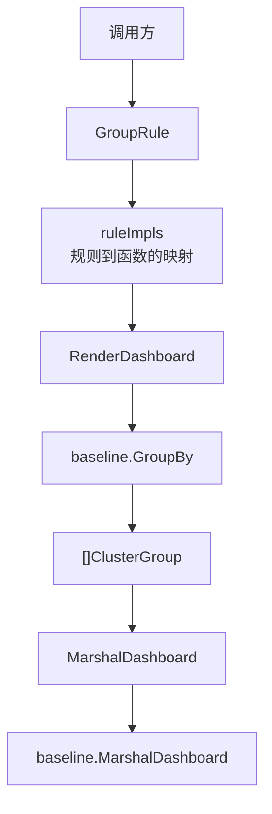

# Data-driven Dashboard 分组方案

本方案用静态规则表选择分组 key 和组间 comparator，验证“规则是数据”是否比 switch 更易维护。
它与 [baseline](../baseline/README.md) 共用领域模型、分组/排序核心、JSON 编码和共同行为测试；
本 package 只保留规则映射与数据驱动入口。

## 文件结构

| 文件 | 职责 |
| --- | --- |
| [`dashboard.go`](./dashboard.go) | 查找规则映射，并委托 `baseline.GroupBy` 返回集群分组 |
| [`rules.go`](./rules.go) | 规则类型/常量别名及 `ruleImpls` 映射表 |
| [`model_aliases.go`](./model_aliases.go) | 共享 baseline 领域类型别名 |
| [`json.go`](./json.go) | 对外 JSON 集成边界，委托 `baseline.MarshalGroups` |
| [`dashboard_test.go`](./dashboard_test.go) | 测试规则映射完整性及分发结果 |
| [`public_api_test.go`](./public_api_test.go) | 从包外验证 API 可用性 |
| [`example_test.go`](./example_test.go) | 展示可复制的调用方式 |
| [`../cmd/datadriven-demo/main.go`](../cmd/datadriven-demo/main.go) | 命令行演示入口 |

共享算法、服务 mask、比较器、15 种组合 fixture 以及分组行为测试仅在 baseline 维护。
删除了原先重复的 `mask.go` 和 `compare.go`，避免各方案的核心行为逐渐产生差异。

## 架构



## 规则表

| 规则 | 分组 key | 组间排序 |
| --- | --- | --- |
| `RuleExactCombination` | `baseline.MaskOf` | `baseline.CompareByMaskDesc` |
| `RuleExactServiceCount` | `baseline.MaskOf` | `baseline.CompareByServiceCount` |
| `RuleExactPrimary` | `baseline.MaskOf` | `baseline.CompareByPrimary` |
| `RuleExactConvention` | `baseline.MaskOf` | `baseline.CompareByConvention` |
| `RulePrimaryService` | `baseline.PrimaryServiceMask` | `baseline.CompareByMaskDesc` |

表中只有“如何选择两个函数”的方案差异。服务器归组、未知服务/无服务处理、组内服务器排序、
服务器内 Services 排序及 JSON 形状都由 baseline 共用，因此能直接聚焦比较分发结构。

## 排序职责

| 责任 | 实际逻辑 |
| --- | --- |
| 服务分组 | 规则表提供 key 函数；共享 `baseline.GroupBy` 按 key 聚合 |
| 组间排序 | 规则表提供 comparator；特殊未知服务组在已知组之后、无服务组之前，无服务组固定最后 |
| 组内服务器排序 | baseline 按服务器状态、服务类型/角色、服务列表长度、IP、Name 排序 |
| 服务器内服务排序 | baseline 先克隆 Services，再按 AS→TS→SS→DS 排序，不修改输入 |

## 调用示例

```go
import (
    "dashboardService/baseline"
    "dashboardService/datadriven"
)

clusters := datadriven.RenderDashboard(servers, datadriven.RuleExactConvention)
jsonBytes, err := baseline.MarshalDashboard(servers, datadriven.RuleExactConvention, baseline.JSONNested)
if err != nil {
    return err
}
```

当规则无效时，`RenderDashboard` 会 panic，与 baseline switch 入口的无效规则行为一致。
对外规则字符串解析使用 `ParseGroupRule`，无效名称会返回 error。

## POC 取舍

新增规则时，数据驱动方案通常只需增加一条映射，规则表也可作为完整性清单集中阅读。
但映射不会被编译器检查为穷举；表项数与规则清单的对应由专属测试保证。当前规则数量少且不需要
运行时配置，因此与 switch 相比，主要收益是规则清单的集中表达，而非动态能力。

| 分发方案 | 调用方式 | 是否可枚举/按名称解析 | 主要取舍 |
| --- | --- | --- | --- |
| baseline switch | `RenderDashboard(servers, rule)` | 是 | 分支直观，适合规则少且稳定 |
| 本方案 Data-driven | `RenderDashboard(servers, rule)` | 是 | 规则映射集中，容易阅读规则清单 |
| Functional Options | `NewGrouping(With..., With...).Apply(servers)` | 不以业务规则为主 | 配置灵活，但暴露 key/comparator 细节 |
| [闭包组合](../closure/README.md) | `RulePrimaryService(servers)` | 否 | 直接调用简洁，但函数不是可解析的规则元数据 |

闭包可以作为内部规则实现，不过若应用需要通过配置字符串选择规则，仍需枚举或名称映射；
闭包本身不能代替本方案的 `GroupRule` 和 `ParseGroupRule` 契约。

## 运行与测试

```powershell
go run ./cmd/datadriven-demo
go test ./datadriven
go run ./cmd/closure-demo
go test ./...
```

共同行为变更应在 baseline 的共享测试中验证；datadriven 测试只覆盖映射缺项、映射数量及入口委托
是否与基线一致。
