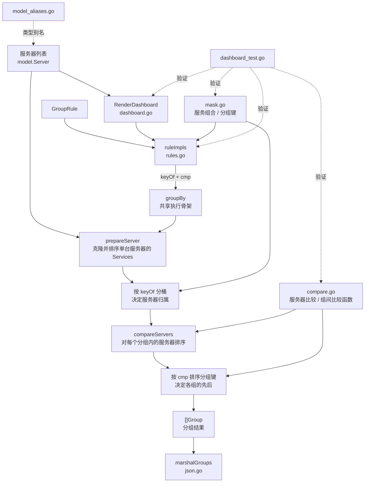

# Data-driven Dashboard 分组方案

> 本方案聚焦已获取的集群服务器与服务数据，展示如何用规则表选择分组键和组间排序，
> 并由共享流程完成分组。它不负责在线数据加载或 HTTP 接口处理。

## 目录结构

| 文件 | 职责 | 主要内容 |
| --- | --- | --- |
| [`dashboard.go`](./dashboard.go) | 分组执行与统一入口 | `Group` 结果类型、`groupBy` 共享执行骨架、`RenderDashboard` 规则分发入口及演示代码 |
| [`rules.go`](./rules.go) | 规则声明与解析 | `GroupRule`、规则名称解析、`ruleImpls` 决策表 |
| [`mask.go`](./mask.go) | 服务组合表达 | 服务优先级、bit 布局、组合约定顺序、mask 计算与组合名称 |
| [`compare.go`](./compare.go) | 三类排序逻辑 | 服务器内 `Services` 排序（`prepareServer`）、组内服务器排序（`compareServers`）、组间排序比较函数（`cmpBy...`） |
| [`json.go`](./json.go) | JSON 序列化 | `marshalGroups`，封装分组结果的 JSON 编码 |
| [`model_aliases.go`](./model_aliases.go) | 共享领域模型适配 | 将共享 `model` 中的服务器、服务、状态及角色类型映射到本 package 使用的名称 |
| [`dashboard_test.go`](./dashboard_test.go) | 行为与不变量测试 | bit 定义、规则表完整性、规则顺序、边界输入、输入无副作用及规则解析测试 |

所有 Go 文件属于同一个 `datadriven` package；按文件拆分是为了按职责组织代码，并未拆成多个 package。

## 架构设计

### 模块关系



### 分组与三种排序职责

需要区分一项分组职责和三种不同对象的排序。分组决定服务器归属；排序只决定既有对象的展示先后：

| 职责 | 处理对象 | 实现位置 | 规则 / 依据 | 结果影响 |
| --- | --- | --- | --- | --- |
| **服务分组** | 输入服务器集合 | `rules.go` 选择 `keyOf`；`mask.go` 的 `maskOf` / `primaryServiceMask` 计算分组键；`dashboard.go` 的 `groupBy` 按键分桶 | 前四种规则用完整服务组合 mask；`RulePrimaryService` 用最高优先级服务 bit；空 `Services` 进入 `Key=0` 的“无服务”组 | 决定每台服务器属于哪个服务组；空服务服务器不会丢失 |
| **组间排序** | 已形成的各个服务组（实际比较其分组键） | `rules.go` 选择 `cmp`；`compare.go` 提供比较函数；`dashboard.go` 的 `groupBy` 排序分组键 | 由当前规则决定：mask、服务数量、主服务优先级或业务约定顺序 | 只决定各服务组的显示先后，不改变服务器归属 |
| **组内服务器排序** | 同一个服务组中的多台服务器 | `compare.go` 的 `compareServers`，由 `dashboard.go` 的 `groupBy` 对每组调用 | 依次比较服务器状态、AS→TS→SS→DS 对应服务的状态、IP、名称 | 只决定同一组内服务器的先后，不改变组别 |
| **服务器内服务排序** | 单台服务器的 `Services` 切片 | `compare.go` 的 `prepareServer` | 按 `mask.go` 的服务优先级 AS→TS→SS→DS 排列；先克隆切片以避免修改输入 | 只整理单台服务器内服务列表的展示顺序，不影响分组或服务器顺序 |

特别注意：`prepareServer` 对 `Services` 的排序只是展示整理，不参与分组键计算。`maskOf` 按服务类型计算组合；`compareServers` 也按服务类型查找对应服务状态，因此两者都不依赖 `Services` 切片的排列顺序。

### 一次分组请求的数据流

| 阶段 | 所在位置 | 处理内容 |
| --- | --- | --- |
| 1. 选择规则 | `RenderDashboard` → `ruleImpls` | 根据 `GroupRule` 取得该规则对应的 `keyOf` 与 `cmp` |
| 2. 准备每台服务器 | `groupBy` → `prepareServer` | 克隆该服务器的 `Services` 切片，并按 AS→TS→SS→DS 整理服务列表；这是服务器内部排序，不是组内服务器排序 |
| 3. 服务分组 | `groupBy` → 规则 `keyOf` → `maskOf` / `primaryServiceMask` | 有服务的服务器按完整组合或主服务分组键分桶；空 `Services` 的服务器进入 `Key=0`、“无服务”组 |
| 4. 组内服务器排序 | `groupBy` → `compareServers` | 分别对每个组中的服务器排序，依据服务器状态、各服务状态、IP 和名称 |
| 5. 组间排序 | `groupBy` → 规则 `cmp` | 对已生成的分组键排序，决定各服务组的显示顺序；“无服务”组固定排在最后 |
| 6. 组装结果 | `groupBy` | 生成 `[]Group`，包含内部使用的 `Key`、展示名称及已排序服务器 |
| 7. 编码（可选） | `marshalGroups` | 将分组结果编码为缩进 JSON |

## 规则矩阵

服务组合通过 4 位掩码表示：AS=`1000`、TS=`0100`、SS=`0010`、DS=`0001`。
高优先级服务占据高位，因此掩码数值降序可表达服务优先级组合顺序。

| `GroupRule` | 分组键（决定分组归属） | 组间排序（决定组的先后） | 结果组数上限 | 用途示例 |
| --- | --- | --- | ---: | --- |
| `RuleExactCombination` | 完整服务组合 mask | mask 降序 | 15 | 优先查看服务组合更复杂的节点 |
| `RuleExactServiceCount` | 完整服务组合 mask | 服务数量升序，再按 mask 降序 | 15 | 优先查看单服务节点 |
| `RuleExactPrimary` | 完整服务组合 mask | 主服务优先级、服务数量、mask | 15 | 按主服务优先级组织运维视图 |
| `RuleExactConvention` | 完整服务组合 mask | 按 `comboOrderList` 中的业务约定顺序 | 15 | 遵循指定的产品展示顺序 |
| `RulePrimaryService` | 最高优先级服务的单个 bit | mask 降序 | 4 | 将完整组合投影并合并到 AS、TS、SS、DS 主服务组 |

前四种规则保留精确服务组合，只改变组间顺序；`RulePrimaryService` 改变分组键，将多服务组合归入其最高优先级服务组。`Services` 为空的服务器统一进入 `Key=0` 的“无服务”组，因此会保留在返回结果中，并且不受规则排序影响、固定排在最后；服务列表非空但服务类型无法识别的服务器仍不会进入已定义的服务组合组。

## 设计取舍

| 方面 | 设计方式 | 收益 | 约束 |
| --- | --- | --- | --- |
| 规则选择 | `ruleImpls` 将规则映射到 `keyOf` 和 `cmp` 函数 | 规则差异集中声明；新增规则通常不必改动公共分组骨架 | 新规则需同步维护枚举、规则表、字符串解析和测试 |
| 公共流程 | `groupBy` 固定分桶、组内排序、组间排序和组装步骤 | 多种规则共享执行逻辑，降低重复实现和行为漂移 | 骨架行为变更会影响全部规则，需用规则矩阵验证 |
| 服务组合 | 高优先级服务对应高位的 bit mask | 组合去重简单，组合比较和主服务投影直接 | 调整位布局或增加服务类型时，需同步更新优先级、mask、顺序表及不变量测试 |
| 排序行为 | 服务器比较与多种组间比较函数分离 | 比较规则可独立阅读、测试和替换 | 需要新增对外规则时，还应在规则表中注册相应比较函数 |
| 领域类型 | 通过别名复用 `dashboardService/model` | 避免重复定义服务器、服务、状态等共享领域结构 | 字段和 JSON 标签遵循共享模型；分组响应类型 `Group` 仍由本方案定义 |

该结构融合了**数据驱动的规则表**与**策略式函数分派**：函数值表达规则差异，统一入口负责选择规则；`groupBy` 则是共享的算法骨架，具有模板流程的思想，但并非基于继承的经典模板方法模式。

## 可维护性与演进

| 变化需求 | 主要修改点 | 需要同步验证 |
| --- | --- | --- |
| 新增分组规则 | `rules.go` 增加 `GroupRule`、字符串解析和 `ruleImpls` 表项 | 规则表完整性、规则顺序与结果内容测试 |
| 新增组间排序方式 | `compare.go` 新增比较函数，并在 `rules.go` 引用 | 比较顺序与相等键行为 |
| 新增服务类型 | `model` 类型常量，以及 `mask.go` 的优先级、位映射、组合顺序 | mask 容量、优先级假设、组合覆盖和主服务投影 |
| 改变分组流程 | 修改 `dashboard.go` 的 `groupBy` | 空输入、无服务输入、输入不被修改及全部规则行为 |
| 增加不同页面的输出形状 | 在 `Group` 结果后增加强类型投影或 DTO | JSON 字段契约；不要把 UI 投影职责塞入 `groupBy` |
| 更改 JSON 表示 | 修改 `json.go` 或结果结构的 JSON 标签 | 对外数据契约和序列化测试 |

## 测试

在仓库根目录运行：

```powershell
go test ./datadriven
```

运行全部方案测试：

```powershell
go test ./...
```
