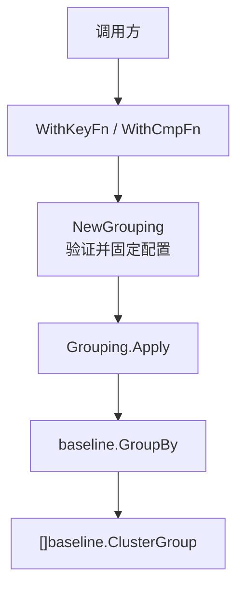

# 函数式选项 Dashboard 分组方案

> 本方案验证 Go 常见的 Functional Options 配置方式是否适合当前“选择一个预定义分组规则”的需求。
> 领域类型、分组核心、排序比较器、fixture 和共同行为测试统一由 [`baseline`](../baseline/README.md) 提供；
> 本 package 只实现选项配置和调用入口。

## 目录结构

| 文件 | 职责 |
| --- | --- |
| [`options.go`](./options.go) | `Option`、`WithKeyFn`、`WithCmpFn`、`NewGrouping` 和 `Grouping.Apply` |
| [`model_aliases.go`](./model_aliases.go) | 将共享 baseline 类型重新导出到本方案 |
| [`dashboard_test.go`](./dashboard_test.go) | 从包外验证默认配置、选项组合、无效配置和公开调用方式，并含可执行示例 |
| [`../cmd/options-demo/main.go`](../cmd/options-demo/main.go) | 命令行演示入口 |

`baseline` 集中持有重复实现：共享数据模型、规则常量、掩码算法、比较器、分组流程、
JSON 编码、组合 fixture 及这些行为的完整测试。`options` 不复制上述代码，也不重复这些测试。

## 架构



默认配置是完整组合 mask 分组、mask 降序。选项在构造时应用；创建完成后，`Grouping` 的配置字段
不可从包外修改。`NewGrouping` 遇到 nil Option、nil key 函数或 nil comparator 会返回错误。

## 调用示例

```go
grouping, err := options.NewGrouping(
    options.WithKeyFn(baseline.PrimaryServiceMask),
    options.WithCmpFn(baseline.CompareByMaskDesc),
)
if err != nil {
    return err
}

clusters := grouping.Apply(servers)
```

调用方必须了解并选出具体函数。这与 `baseline.RenderDashboard(servers, RulePrimaryService)` 的规则名称不同：
Functional Options 将内部 key 函数和 comparator 暴露给配置调用方，调用形式更适合需要自由组合配置的场景，
但需要比较的基础对象是固定的五种预定义规则。

## 与 Builder 和规则分发表比较

| 维度 | Functional Options | Builder | `datadriven` 规则表 | baseline switch | [`closure`](../closure/README.md) |
| --- | --- | --- | --- | --- | --- |
| 调用形式 | `NewGrouping(With..., With...)` | 链式 `.With...().Build()` | `RenderDashboard(servers, rule)` | `RenderDashboard(servers, rule)` | `RulePrimaryService(servers)` |
| 状态/载体 | 配置创建后固定 | Builder 对象累积配置 | 静态规则映射表 | 直接代码分支 | 函数变量作为规则 |
| 调用方表达 | 指定 key 函数与 comparator | 逐步指定构造参数 | 选择业务规则名 | 选择业务规则名 | 直接调用规则函数 |
| 规则可枚举/可解析 | 不适用 | 不适用 | 支持 | 支持 | 不支持规则函数到名称的反向解析 |
| 适配当前需求 | 较弱：配置自由度超过调用方需求 | 较弱：没有分步构建需求 | 较好：规则是预定义集合 | 较好：规则少且稳定 | 直接调用简洁，但缺少规则元数据 |

## POC 结论

Functional Options 是 Go 常见、易扩展的配置范式，但“流行”不代表适用于所有场景。这里调用方只需要选择
一个业务规则，选项方案却要求知道并配对底层 key/comparator 函数，暴露实现细节且允许没有业务意义的组合。
该模式适合调用方确实需要自由组合分组键和排序函数的扩展点；若规则集合固定，switch 或规则表更直接。

## 运行

```powershell
go run ./cmd/options-demo
go test ./options
go test ./...
```
