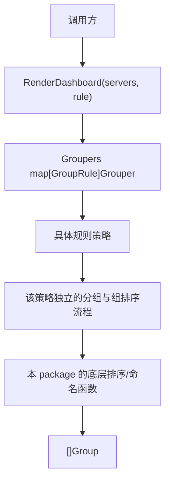

# Pure Strategy 分组方案

本 package 是规则分发 POC 的“纯策略模式”对照组。每个分组规则都实现 `Grouper` 接口，
并在自己的 `Group` 方法中独立执行输入准备、分桶、组排序和结果组装。`Groupers` 注册表负责
按 `GroupRule` 选择具体策略。为免无关底层细节淹没对比，服务优先级、组名及组内比较的基础
函数在本 package 内共享；各策略不调用 baseline 的分组、mask 或排序实现。

## 架构



## 文件结构

| 文件 | 职责 |
| --- | --- |
| [`strategy.go`](./strategy.go) | `Grouper` 接口、策略注册表及选择入口 |
| [`implementations.go`](./implementations.go) | 五个策略各自独立的分组/排序/结果构造实现 |
| [`model_aliases.go`](./model_aliases.go) | 复用 baseline 的输入和输出领域类型 |
| [`strategy_test.go`](./strategy_test.go) | 对照 baseline 验证规则结果、空输入和输入不可变性 |

## 策略清单

| 规则 | 具体策略 | 分组键 | 组间排序 |
| --- | --- | --- | --- |
| `RuleExactCombination` | `exactCombination` | 完整服务组合 | mask 降序 |
| `RuleExactServiceCount` | `exactServiceCount` | 完整服务组合 | 服务数升序，再 mask 降序 |
| `RuleExactPrimary` | `exactPrimary` | 完整服务组合 | 主服务、服务数、mask |
| `RuleExactConvention` | `exactConvention` | 完整服务组合 | 固定业务顺序 |
| `RulePrimaryService` | `primaryService` | 最高优先级服务 | mask 降序 |

```go
groups := purestrategy.RenderDashboard(servers, baseline.RulePrimaryService)
```

也可以直接调用某个注册策略：

```go
groups := purestrategy.Groupers[baseline.RulePrimaryService].Group(servers)
```

## 与共享骨架方案的比较

| 维度 | Pure Strategy | baseline / Data-driven / Closure |
| --- | --- | --- |
| 每条规则 | 独立完整实现，单规则可在一个方法内阅读 | 规则选择与共享分组骨架分离 |
| 修改共同步骤 | 分桶、特殊组、组排序、结果组装等逻辑复制在各策略中，需要逐一同步 | 修改共享实现一次 |
| 新增规则 | 新增策略类型、完整实现、注册表项及测试 | 新增分支、表项或闭包规则 |
| 编译/运行时选择 | 接口 + 注册表，可运行时替换实现 | 依方案使用 switch、映射或闭包 |
| 维护风险 | 重复实现可能逐渐行为漂移；注册 map 本身也需保证规则齐全 | 共享实现集中，方案差异较小 |

这份 POC 刻意保留五份相似的执行骨架，目的是展示抽象力度与需求的匹配关系，不代表建议生产代码
复制核心算法。例如给每份实现的输入准备/分组阶段增加日志，需要分别修改和验证五个策略；底层
`compareServers` 等共享辅助函数仍只需改一处。相比之下，baseline 的共享骨架只需在共同执行流程处
修改一次。策略模式本身并非问题；当各策略确实拥有不同算法时，它是合适的扩展点。当前五种规则仅
改变 key/comparator，复制整个算法骨架会把小差异放大成多份维护责任。

为了保持 POC 规则结果一致，本方案复用 baseline 的领域类型，但不调用 baseline 的分组、mask 或排序
实现。测试逐条比较全部五种规则，并覆盖未知服务组、无服务组及输入切片保护。

## 运行与测试

```powershell
go test ./purestrategy
go test ./...
```
